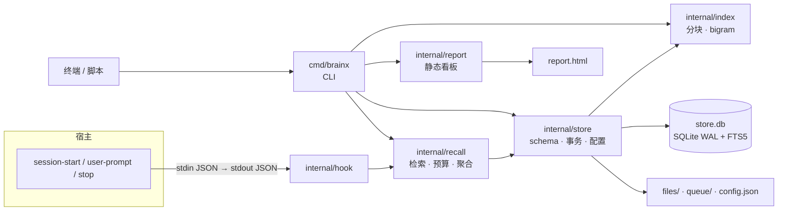

# BrainX

> 单二进制 · 单目录 · 单 SQLite · 零常驻服务 · 默认零模型

这个系统成因是当时各Agent的记忆系统并未完善，而karpathy提出来wiki之后都在建知识库wiki。而当时做的事非常需要经验主导，一直都没有一个合适的记忆性的东西，所以着手写了一个可以脱机使用的符合我主观+客观经验记录的系统协同，加上后背的知识库wiki就节省了很多时间。现在成熟产品和插件很多，BrainX也花了点时间做了梳理和重构，在一些特殊的非在线场景下使用还是挺不错的。

其次这不是一个完整产品，仅限于能用。本身一个人就是在抗压的情况下逆人性状态做出来的。但是整体的架构思路可以供需要的人使用。

> 发之前花了一些时间做一些操作系统和Agent适配，Agent我只测了codex。其他的不浪费时间了，遇到的问题应该都是在hook那里，实在懒的让Agent去排查一下就好。
> 安装完成后Agent的权限应该完全放开，不然会有无法写sqlite的问题。这种问题各自取舍或者自己让Agent适配吧。我自己用完全放开权限所以这个我就没去处理。

## 为什么做这个

- **记忆散落在会话里**：每个工具都有自己的上下文窗口，换个会话、换个宿主，经验和判断就没了。
- **现有方案太重**：要么 Docker 三件套加账号体系，要么自带几百 MB 的本地模型，要么把数据推到云端。个人使用不需要这些。
- **私有资料不能出本机**：项目文档、笔记、代码片段，需要一个「默认离线、能整体拷走」的底座。

所以 BrainX 只做一件事：**把「我不能外传的文档 + 我积累的判断」放进一个能整体带走、原文永不改写、每次会话自动进上下文的库。**

## 核心特点

- **单个 Go 二进制，零常驻**：不开端口、不起服务、不装 Docker、不需要账号；`CGO_ENABLED=0` 静态构建。
- **默认完全离线**：正常路径不联网、不调模型；引擎里没有任何模型客户端。
- **一个 SQLite 承载全部**：`store.db`（WAL + FTS5）+ `files/` + `config.json`，备份 = 拷贝一个目录。
- **中文按字检索**：不用分词词典，rune bigram 直接写进 FTS5，`bm25` 标题权重 5.0 / 正文 1.0，异常查询走有超时上限的 LIKE 兜底。
- **给宿主用的注入接口**：`brainx hook` 读宿主 JSON、只往 stdout 写 `hookSpecificOutput.additionalContext`，`stop` 事件保持空输出。
- **单文件离线看板**：`brainx report [--open]` 生成 `report.html`，`file://` 打开，无 CDN、无端口、无常驻。六区块：四 KPI / 近 30 天双轴图 / kind 构成 / 待办三栏 / 三条资产榜 / 配置区。每个数字带 ⓘ 口径；页面唯一能写的是 `config.json`（合并写，保留不认识的键）与 `queue/cmd/*.json`（排队，执行一次即删）。按钮文案是「排入队列，下次运行 brainx 时执行」，不写「立即执行」——静态页起不了进程，这是唯一会让人对页面失去信任的地方。
- **迁移即拷贝**：库内引用一律相对路径，`cp -r` 到新目录后立即可用。

## 与同类方案的取舍

| 类型            | 形态                | 借了什么                                   | 放弃了什么                     | 原因         |
| ------------- | ----------------- | -------------------------------------- | ------------------------- | ---------- |
| 进程内插件型        | 作为插件或库跑在宿主进程内     | 重要性衰减、去重、逐条来源可观测                       | 多层 Provider 抽象、绑定宿主内部 API | 换宿主即失效     |
| 本地模型自动化型      | CLI + 本地模型做巩固     | keep / merge / archive 决策清单、审计链、RRF 融合 | 运行时版本门槛、数百 MB 模型闭包、上百个配置键 | 部署成本大于收益   |
| 流量代理型         | 站在模型 API 路径上的网关   | 资产统一登记、L0–L3 分层、预算化召回                  | 容器编排、两组模型配置、改宿主 base URL  | 宿主改协议就断线   |
| 知识库 / RAG 平台型 | 独立服务 + 向量库 + 管理界面 | 零依赖单机部署、迁移 = 拷目录、记忆与文档同库               | 多组件集群、RBAC / 多空间、重型前端     | 个人场景不需要团队层 |
| 云端记忆服务型       | 云端 API + 账号       | 开箱即用                                   | 数据离开本机、需要密钥与网络            | 私有语料不能外传   |

**最本质的一条差异**：统一接口不是 MCP，也不是 Proxy，而是「**宿主能跑一条 shell 命令**」。

- 主流宿主的 hook 格式已经收敛到同一套，一份配置能覆盖多家；MCP 客户端的接入配置各家不同，选它反而要写多份。
- MCP 本身不负责注入，花最大装配成本只买到一个接口。
- CLI 不需要协议协商、不需要常驻进程、不需要端口。

代价只有一个：hook 每轮起一次进程。这正是选 Go 而不是 TypeScript 的唯一理由——冷启动毫秒级。


## 目录

- [为什么做这个](#为什么做这个)
- [核心特点](#核心特点)
- [与同类方案的取舍](#与同类方案的取舍)
- [安装与卸载](#安装与卸载)
- [为什么这么设计](#为什么这么设计)
- [四条硬契约](#四条硬契约)
- [架构](#架构)
- [命令](#命令)
- [数据与迁移](#数据与迁移)
- [兼容性](#兼容性)
- [里程碑与验收结果](#里程碑与验收结果)
- [License](#license)

## 安装与卸载

### 从源码编译

```sh
# 0) 下载并编译（GitHub 页面 Code → Download ZIP 也可以）
git clone https://github.com/ksi512/BrainX-prototype.git && cd BrainX-prototype
CGO_ENABLED=0 go build -o brainx ./cmd/brainx

# 1) 初始化库（默认 ~/.brainx）
BRAINX_BIN="$PWD/brainx"
"$BRAINX_BIN" init

# 2) 装到宿主：在非 git 仓库目录执行，默认写全局配置
cd ~
"$BRAINX_BIN" install            # 想先看会写什么，加 --dry-run

# 3) 让 PATH 生效
source ~/.zshenv                 # Linux 非 zsh 用 ~/.profile；或重开终端

# 4) 检查
brainx --version
brainx status
```

### 预编译包方式（普通用户）

从 [GitHub Releases](https://github.com/ksi512/BrainX-prototype/releases) 下载对应平台的压缩包，解压后执行。

macOS / Linux：

```sh
chmod +x brainx
./brainx init
cd ~ && /path/to/brainx install
source ~/.zshenv
```

Windows：

```powershell
.\brainx.exe init
.\brainx.exe install
```

Windows 的 `install` 不会自动修改 PATH；按安装结果提示把 `%USERPROFILE%\brainx\bin` 加入 PATH，或直接用绝对路径。


### 装完之后

- 重启 Agent，`SessionStart` 会自动注入 brief——**不需要在对话里说“开启”**。
- 直接说“记住：……”或“我之前定的……是什么？”，Agent 会调用 `brainx remember` / `brainx recall`。
- Codex Desktop 首次装完要去 **Settings → Hooks** 点 **Reload hooks** 并信任；CLI 才用 `/hooks`。否则 hook 静默不跑。
- Codex Desktop 还要让 sandbox 能写 `~/.brainx`；如果 `brainx status` 报 `unable to open database file (14)`，先按下文「Codex Desktop 的三个前提」的情况 A/B 放行，否则会出现“能注入、不能记住”。

### 卸载

卸载：`brainx install --uninstall`；连库一起删：`brainx install --uninstall --purge --yes`（`--purge` 必须配 `--yes`）。


## 为什么这么设计

### 1. CLI 主干 + 逐宿主 hook，不做 Proxy

Proxy 靠「改 base URL + 截流量」换自动注入，代价是全量对话过它、宿主改协议就断线。BrainX 选择不碰流量：一个 `brainx` 命令 + 一行 hook 配置。

- **代价**：每轮一次进程启动，安装器要逐宿主适配。
- **不做**：不改宿主请求、不做协议适配层、不做网关。

### 2. 判断交给Agent，引擎不调模型

巩固需要判断（保留 / 合并 / 归档），但这个判断不该由引擎做：宿主此刻就带着模型和最近的上下文，质量更好。

`dream` 设计成两段式：`--plan` 出候选，`--apply` 应用判断——`--plan` 只产出候选与理由，零模型调用、零资产写入；`--apply` 只校验与落库（合法 plan、合法决策、不可变约束）。

结果：引擎没有任何模型配置项，不借宿主模型，不打包模型权重。

### 3. 一个 SQLite，不引向量库

FTS5 是 SQLite 内置的。向量默认关闭；启用时也只是显式配置一个 embeddings 端点，暴力算余弦——万级 chunk 在毫秒级，不需要 ANN 索引、不需要扩展、不需要 ONNX 运行时。

### 4.web看板和旋钮

生成看板：

```sh
brainx report
brainx report --open          # 生成后直接打开
brainx report --out /path/to/report.html
```

默认写到 `$BRAINX_HOME/report.html`（通常是 `~/.brainx/report.html`），用 `file://` 打开；不需要启动服务，也没有端口。页面要写配置或排队时，浏览器需要支持目录授权（Chrome / Edge），点「选择 $BRAINX_HOME」选中数据目录即可。

页面内容：四块 KPI、近 30 天入库/召回趋势、资产 kind 构成、待办三栏、三条资产榜，以及配置区。配置区只放 15 个基础旋钮，按组如下：

| 组 | 旋钮 |
|---|---|
| 归档与原件 | 新导入文档的原件默认去向（`local` / `text-only` / `ext:<root>:<relpath>`） |
| 整理与衰减 | 资产总量上限、记忆衰减速度、自动整理最小间隔 |
| 召回与注入 | 单次召回条数、单次召回字数、召回超时（毫秒） |
| 上下文与提示 | 会话上下文上限（字）、「待整理」条数门槛、「待整理」天数门槛 |
| 待确认 | 待确认队列上限、自动确认分数门槛 |
| 导入 | 解析并发数、单文件上限（MB） |
| 下载 | 下载上限（MB） |

页面上的「写入 config.json」只合并写入你改过的键；「确认 / 排入机械层 / 排入补写重放」只是写 `queue/cmd/*.json`，下次运行任意 `brainx` 命令时才执行，不会在页面里立即执行。其余高级配置可用 `brainx config schema` / `brainx config set` 在 CLI 处理；只读项用 `brainx config schema` 查看，页面不写。

## 四条硬契约

| 契约              | 含义                                                                | 为什么不可协商               |
| --------------- | ----------------------------------------------------------------- | --------------------- |
| **原文不可变**       | `kind=doc` 的正文永不改写；派生资产必须带 `derived_from`                         | 检索结果要能追溯回原文，否则库会自我污染  |
| **归档三档 + 相对路径** | 正文在库内；原件可 `local` / `text-only` / `ext:<root>:<relpath>`；库内只存相对路径 | 换机器、换用户名、拔掉 NAS 后仍然可用 |
| **中文二字词可检索**    | rune bigram + FTS5，不用词典、不用 trigram                                | 中文不分词就查不到；词典会随领域漂移    |
| **被动闭环**        | hook 自动注入；整理只出候选，判断留给宿主                                           | 没有常驻进程，也要「越用越顺」       |

## 架构




| 层  | 包                 | 职责                                     |
| -- | ----------------- | -------------------------------------- |
| 入口 | `cmd/brainx`      | 子命令、参数、退出码                             |
| 接入 | `internal/hook`   | 宿主事件 → 上下文 JSON                        |
| 检索 | `internal/recall` | 三路召回（FTS5 / 图谱 / 时序）、RRF 融合、字符预算、上下文拼装 |
| 索引 | `internal/index`  | rune 分块、bigram 分词                      |
| 存储 | `internal/store`  | schema、事务、配置、资产读写                      |
| 交付 | `internal/report` | 单文件离线看板                                |

**数据流**

1. **写入**：`store.Create` 单事务落 `assets + asset_tags + chunks + chunks_fts + events`。
2. **读取**：bigram 分词 → `chunks_fts MATCH` + `bm25` → 按资产去重聚合 → 按字符预算裁剪。
3. **注入**：`cwd` 哈希为 `proj:<12 位>` → 取高层级资产 → 拼 `## 已知上下文` → hook JSON。

**数据模型**：`assets`、`asset_tags`、`chunks`、`chunks_fts`、`edges`、`runs`、`events`、`reviews`、`meta`。详见 [SCHEMA.md](SCHEMA.md)。


硬性要求：

- **写操作必须显式 `--scope`**，否则退出码 2 且不落库；`--scope proj` 会解析成当前仓库的 `proj:<hash>`，不在仓库里直接报错。
- `search` 空查询 = 列举；不给 `--scope` 时按 cwd 判定（向上找 `.git`，取 remote 哈希或目录名），依据打在 stderr——子目录与仓库根目录判成同一个 scope。
- `update` 改写记忆型资产并**同步重建 FTS 索引**（旧词立刻查不到）；`kind='doc'` 一律拒绝改写，原文不可变。
- `recall` / `context` 尾部会带一行冲突提示（`⚠ 与 [id] 存在冲突`），冲突方不参与排序、不强化。
- `import` 支持 md / txt / html / docx / pdf / xlsx；抽出的正文入库，原件按 `--archive` 三档归档（`local` 落 `files/`、`text-only` 不留、`ext:<root>:<rel>` 记命名根下的相对路径）。xlsx 会转成 Markdown 表格（每片都带表头）；xls 明确提示另存为 xlsx，不静默导入空内容。
- `get --open` 取原件：路径型根直接给绝对路径，URL 型根只在这一刻下载并缓存；原件不可达时**退出码 4**，检索不受影响。
- `remember` 走写入质量判断：过短 → `pending`，与既有正文完全相同或被拒过 → 直接拒绝（`--force` 可强制写入）。
- `dream --apply <file|->` 是两段式的第二段：校验 `plan_id` 必须是最近一次清单、整批原子（错一条全不落）、`doc` 永不改写。
- brief 最前可能出现一行 `[brainx] 待整理 N 条 / D 天 → brainx dream --plan`，跑过 `--plan` 即消失；同一会话的增量注入不会重复带。
- `install` 幂等写入宿主 hook 配置，支持 `--dry-run` / `--uninstall` / `--purge` / `--only`；未显式指定 WorkBuddy 时，只有检测到 `~/.workbuddy`（或项目 `.workbuddy`）才写技能包；卸载会一并收回自装二进制、PATH 行与空目录，`$BRAINX_HOME` 默认保留，加 `--purge --yes` 才会连库一起删（拒绝家目录、根目录和常见用户目录，并要求 `manifest.json` 存在）。

### 常用命令与参数

只列人工在终端里常用的命令；宿主自动调用与维护/低频命令不在这里展开，完整清单运行 `brainx`（无参数）查看。

常用前缀：

```text
init install config status doctor scope
remember import update forget confirm
search recall context get list
dream export report wiki
```

通用约定：

- `--scope` 取值：`global`、`proj`（按当前目录解析成 `proj:<hash>`），或显式 `proj:<hash>`；写操作必须给。
- 布尔参数不带值；带值参数可写 `--flag value` 或 `--flag=value`，值里有空格时加引号。
- 位置参数（`<text>`、`<id>`）可以写在参数前或参数后，例如 `brainx remember "…" --scope global`。
- 环境变量：`BRAINX_HOME` 指定数据目录（默认 `~/.brainx`）；`install` 另用 `HOME` 决定宿主配置落点。
- `brainx --version` / `brainx --help` 不需要先 `init`。

退出码：

| 码 | 含义 |
| --- | --- |
| 0 | 成功 |
| 1 | 一般错误（读写失败、体检未通过等） |
| 2 | 参数错误、写操作缺 scope、非法枚举值 |
| 3 | 找不到资产 / 文件 / run |
| 4 | 原件不可达（只影响取原件，不影响检索） |
| 5 | dream 判断文件非法（plan_id、op、不可变约束） |
| 6 | 写锁重试耗尽（内容已落 queue） |
| 7 | 库损坏 / schema 不符 |
| 8 | 外部下载失败 |

#### `brainx init`

```sh
brainx init
```

无参数。建 `$BRAINX_HOME` 目录树、`store.db`、`config.json`、`manifest.json`、`AGENTS.block.md`。

#### `brainx install`

```sh
brainx install [--dry-run] [--uninstall [--purge --yes]] [--only <hosts>]
               [--prefix <dir>] [--no-path]
               [--global | --project | --both]
               [--agents-target <auto|override|main>]
```

| 参数 | 取值 / 默认 | 说明 |
| --- | --- | --- |
| `--dry-run` | 关 | 只打印会写哪些文件，不落盘 |
| `--uninstall` | 关 | 移除 hook、标记块、`config.toml` 自己那行、自装二进制、PATH 行、空目录 |
| `--purge` | 关 | 必须与 `--uninstall` 同用，且必须加 `--yes`：连 `$BRAINX_HOME` 一起删除；拒绝家目录、根目录和常见用户目录，并要求 `manifest.json` 存在 |
| `--only <hosts>` | 逗号分隔；默认探测 | 只处理指定宿主：`claude-code` / `codex` / `cursor` / `dsh` / `workbuddy`；拼错退出码 2 |
| `--prefix <dir>` | macOS/Windows `~/brainx/bin`；Linux `~/.local/bin` | 自装二进制落点 |
| `--no-path` | 关 | 跳过写 shell PATH |
| Windows PATH | — | `install` 不自动改 Windows PATH；请把 `%USERPROFILE%\brainx\bin` 加入 PATH，或直接用绝对路径 |
| `--global` | 自动 | 只写全局配置 |
| `--project` | 自动 | 只写项目级配置（在 git 仓库里默认就是项目级） |
| `--both` | 关 | 全局与项目级都写 |
| `--agents-target` | `auto` | 约定文件落点：`auto`（override 非空就写 override）/ `override` / `main` |

不带 `--only` 时只处理探测到的宿主。DSH 只打印桥接包说明，不写文件。

#### `brainx config`

```sh
brainx config schema
brainx config get <key>
brainx config list
brainx config set <key> <value>
```

| 子命令 | 参数 | 说明 |
| --- | --- | --- |
| `schema` | — | 打印配置 schema（键、类型、范围与默认值） |
| `get` | `<key>` | 打印单个键的当前值 |
| `list` | — | 列出所有键、当前值与来源（默认值 / 配置文件） |
| `set` | `<key> <value>` | 校验类型与范围后写 `config.json`，并记一条 `op=config` 审计；未知键拒绝 |

#### `brainx status`

```sh
brainx status
```

无参数。输出资产按 kind/status 计数、分层分布、`db_bytes`/`files_bytes`、`queue` 深度等。

#### `brainx doctor`

```sh
brainx doctor [--repair] [--retry-dead]
```

| 参数 | 说明 |
| --- | --- |
| `--repair` | 尝试修复：重建 FTS、清理坏 meta、VACUUM |
| `--retry-dead` | 把 `queue/dead/` 的死信移回 `queue/` 再试一次 |

不带参数时先全量补写队列，再检查完整性、FTS、孤儿 chunk、悬空边、WAL、归档根、绝对路径、向量模型。

#### `brainx scope`

```sh
brainx scope
```

无参数。打印当前目录解析出的 scope、仓库根和判定依据；排查“为什么没读到项目记忆”时先用它。

#### `brainx remember`

```sh
brainx remember <text> --scope <global|proj> [--kind <kind>] [--title <title>] [--tag <tag>]... [--force]
```

| 参数 | 取值 / 默认 | 说明 |
| --- | --- | --- |
| `<text>` | 必填 | 一条一义的事实/记忆正文 |
| `--scope` | 必填 | `global` 或 `proj`（解析成 `proj:<hash>`） |
| `--kind` | `memory` | `memory` / `fact` / `skill` / `profile` / `note` / `doc` / `synthesis` / `insight` |
| `--title` | 空 | 标题；不填时用正文 |
| `--tag` | 可重复 | 追加标签 |
| `--force` | 关 | 跳过写入质量判断（过短/重复也写） |

#### `brainx import`

```sh
brainx import <path...> --scope <global|proj> [--kind <kind>] [--title <title>]
              [--archive local|text-only|ext:<root>:<rel>] [--tag <tag>]...
              [--move] [--replace]
brainx import <in.mbz> [--replace]
```

| 参数 | 取值 / 默认 | 说明 |
| --- | --- | --- |
| `<path...>` | 必填 | 一个或多个文件，也接受 `http(s)://` 直链 |
| `--scope` | 必填（`.mbz` 除外） | 写入 scope |
| `--kind` | `doc` | 资产类型；`doc` 不可变 |
| `--title` | 空 | 优先于正文 H1 与文件名 |
| `--archive` | `config archive.default` | `local` 落 `files/`；`text-only` 不留原件；`ext:<root>:<rel>` 只记命名根下相对路径 |
| `--tag` | 可重复 | 追加标签 |
| `--move` | 关 | 导入成功后删除源文件（危险，确认后再用） |
| `--replace` | 关 | 仅对 `.mbz`：覆盖现有库（会先备份旧库；旧 `files/` 移到 `files.bak-*`） |

支持 md / txt / html / docx / pdf / xlsx；xls 会明确要求另存为 xlsx。重复正文默认跳过。

#### `brainx update`

```sh
brainx update <id> [--body <text>] [--title <title>] [--tag <tag>]...
```

| 参数 | 说明 |
| --- | --- |
| `<id>` | 资产 id（支持前缀） |
| `--body` | 新正文；重建 FTS 索引 |
| `--title` | 新标题 |
| `--tag` | 追加标签，可重复 |

只允许记忆型资产；`kind=doc` 一律拒绝改写。

#### `brainx forget`

```sh
brainx forget <id> [--hard]
```

| 参数 | 说明 |
| --- | --- |
| `<id>` | 资产 id |
| `--hard` | 物理删除；`doc` 只允许软删（会报错） |

不带 `--hard` 时置为 `archived`，可回溯。

#### `brainx confirm`

```sh
brainx confirm [<id>...] [--pending] [--reject]
```

| 参数 | 说明 |
| --- | --- |
| `<id>...` | 要激活的待确认资产 |
| `--pending` | 只列待确认资产、未裁决冲突、队列深度 |
| `--reject` | 拒绝并归档，同时写抑制记录，避免同内容再次进 pending |

不带 id 时等同 `--pending`。

#### `brainx search`

```sh
brainx search [<query>] [--scope <scope>] [--kind <kind>] [--limit <n>]
              [--max-items <n>] [--status <status>] [--expand <a,b>]
```

| 参数 | 默认 | 说明 |
| --- | --- | --- |
| `<query>` | 空 = 列举 | 纯词法检索；空查询按 `--status` 列举 |
| `--scope` | 按 cwd 判定 | 读操作会解析 `proj` 并往 stderr 打依据 |
| `--kind` | 空 | 类型过滤 |
| `--limit` | `config recall.max_items`（8） | 返回条数 |
| `--max-items` | 0 | `--limit` 的别名，大于 0 时覆盖 |
| `--status` | `active` | 仅空查询列举时生效 |
| `--expand` | 空 | 逗号分隔的补充词，追加到查询 |

不融合、不进 brief。

#### `brainx recall`

```sh
brainx recall <query> [--scope <scope>] [--kind <kind>] [--limit <n>]
              [--max-items <n>] [--max-chars <n>] [--expand <a,b>] [--status <status>]
```

| 参数 | 默认 | 说明 |
| --- | --- | --- |
| `<query>` | 必填 | 查询词；空查询等同列举 |
| `--scope` | 按 cwd 判定 | 同 `search` |
| `--kind` | 空 | 类型过滤 |
| `--limit` | `config recall.max_items` | 条数上限 |
| `--max-items` | 0 | `--limit` 的别名 |
| `--max-chars` | `config recall.max_chars`（1200） | brief 字符预算，按条目裁剪 |
| `--expand` | 空 | 追加同义词 |
| `--status` | `active` | 仅空查询列举时生效 |

输出带 `id/kind/conf/from`；会回写使用频次与重要度。

#### `brainx context`

```sh
brainx context [--scope <scope>] [--status] [--pending]
```

| 参数 | 说明 |
| --- | --- |
| `--scope` | 默认 `global`；`proj` 会解析 |
| `--status` | 等价执行 `brainx status` |
| `--pending` | 列待确认资产、未裁决冲突、队列深度 |

#### `brainx get`

```sh
brainx get <id> [--open]
```

| 参数 | 说明 |
| --- | --- |
| `<id>` | 资产 id（支持前缀） |
| `--open` | 读完同时打开原件；不可达退出码 4 |

#### `brainx list`

```sh
brainx list [--scope <scope>] [--kind <kind>] [--status <status>] [--limit <n>]
```

| 参数 | 默认 | 说明 |
| --- | --- | --- |
| `--scope` | 空 = 全部 | 按 scope 过滤；`proj` 会解析 |
| `--kind` | 空 | 按类型过滤 |
| `--status` | `active` | 按状态过滤；空值表示全部 |
| `--limit` | `50` | 条数上限 |

#### `brainx dream`

```sh
brainx dream --plan [--mode mutate|derive|both] [--scope <scope>] [--limit <n>]
brainx dream --apply <file|-> 
```

| 参数 | 默认 | 说明 |
| --- | --- | --- |
| `--plan` | — | 只出候选与理由，零资产写入 |
| `--apply <file>` | — | 应用判断 JSON；`-` 表示从 stdin 读 |
| `--mode` | `mutate` | `mutate`（重复/衰减）/ `derive`（派生）/ `both` |
| `--scope` | 空 = 全部 | 限定作用域 |
| `--limit` | `20` | 候选组上限 |

`--apply` 会校验 plan_id、整批原子、`doc` 永不改写。机械层由 `Stop` hook 自动调用，不需要手动跑。

#### `brainx export`

```sh
brainx export <out.mbz>
brainx export --derived --to <dir> [--kind <k1,k2>] [--prune --yes]
```

| 参数 | 说明 |
| --- | --- |
| `<out.mbz>` | 整库压缩备份；不含 `cache/`、`store.db-wal`、`store.db-shm` |
| `--derived` | 导出 Markdown 投影（快照，不可恢复） |
| `--to <dir>` | `--derived` 的输出目录（必填） |
| `--kind` | 逗号分隔的类型白名单；`doc` 不允许导出 |
| `--prune` | 删除导出目录里的孤儿页；必须再给 `--yes` |
| `--yes` | 确认执行 `--prune` |

#### `brainx report`

```sh
brainx report [--out <path>] [--open]
```

| 参数 | 默认 | 说明 |
| --- | --- | --- |
| `--out` | `$BRAINX_HOME/report.html` | 看板输出路径 |
| `--open` | 关 | 生成后打开 |

#### `brainx wiki`

```sh
brainx wiki [--out <dir>]
```

| 参数 | 默认 | 说明 |
| --- | --- | --- |
| `--out` | `$BRAINX_HOME/wiki` | 投影目录；只投影 active 资产，幂等 |


## 数据与迁移

```
$BRAINX_HOME/
  store.db          SQLite（WAL、FTS5）
  config.json       有校验的配置
  manifest.json     库格式与创建时间
  AGENTS.block.md   宿主约定文件正文真源
  files/            库内原件
  queue/            补写队列（queue/cmd 为看板命令，queue/dead 为死信）
  cache/            下载缓存（cache/fetch）
  dict/             词典/扩展数据目录
  wiki/             Markdown 投影目录
  report.html       brainx report 生成的看板
```

- 备份：拷贝整个目录。
- 迁移：`brainx export out.mbz` 生成压缩包；在新机器用 `brainx import out.mbz`（覆盖现有库时加 `--replace`）恢复。库内引用全是相对路径。压缩包不含 `cache/` 与 `store.db-wal` / `store.db-shm`（checkpoint 后它们只是临时文件，恢复时 SQLite 会重建）。

## 兼容性

| 宿主          | 事件                                             | 接入方式          |
| ----------- | ---------------------------------------------- | ------------- |
| Claude Code | `SessionStart` / `UserPromptSubmit` / `Stop`   | 原生 `hooks` 配置 |
| Codex       | 同格式                                            | 原生 `hooks` 配置 |
| Cursor      | `sessionStart` / `beforeSubmitPrompt` / `stop` | 小驼峰扁平配置       |
| DSH         | 经官方桥接包                                         | 需额外插件         |

DSH 本身不读 Claude Code 的 hook 配置，需要官方桥接包：`@deepseek-ai/dsh-hooks-claude-code` 或 `@deepseek-ai/dsh-hooks-codex`（deepseek-ai 维护，仓库 `deepseek-harness/packages/hooks/`）。二选一，两个同时挂会让同一事件执行两遍。装好桥接后，把 `brainx hook` 写进它的 hooks 配置即可。

任何能执行 shell 命令的宿主都可以接入：一行配置指向 `brainx hook --event …` 即可，不需要 MCP、不需要常驻进程。

三种输出格式由 `brainx hook --format claude-code|codex|cursor` 决定；`Stop` 事件不输出任何内容。

### 约定文件的落点：Codex 的 override 遮蔽

Codex **每层只读第一个非空文件**：`AGENTS.override.md` 存在时 `AGENTS.md` 完全不读（全局与项目级同一规则）。所以「写到 AGENTS.md 就算装好」是错的——override 在时那段是死代码。

`install` 因此按 **override 优先** 落点：

```bash
./brainx install --only codex                    # auto：override 非空就写它，否则写 AGENTS.md
./brainx install --only codex --agents-target main      # 强制写 AGENTS.md
./brainx install --only codex --agents-target override  # 强制写 override（不存在就创建）
```

两种落点都只用 \`\` 标记块，**不动你已有的内容**；卸载时两个候选文件都清（用户可能装完后删掉了 override，只看 auto 会留下永远清不掉的残留段）。

**Codex Desktop 的三个前提**（与 CLI 共用 `~/.codex`，但运行方式不同）：

1. Desktop 以应用方式启动，**不继承 shell PATH** → `hooks.json` 里必须是绝对路径（`install` 写的就是 `os.Executable()` 的绝对路径）。
2. 非托管 hook **必须被信任才会跑**，信任绑定到 hook 定义的 hash：改过命令就要重新信任一次。这也是 `install` 必须字节级幂等的原因——否则每次重装都要你重点一遍。
3. **Desktop 的 sandbox 必须允许写 `~/.brainx`**。这一步不做，会出现“新会话能注入，但让 Agent 记住就失败”：
   `brainx: unable to open database file (14)`。
   原因是 SQLite 开了 WAL，连 `brainx status` 都要写 `store.db-wal` / `store.db-shm`；hook 在沙箱外跑，所以能读，Agent 的 shell 在沙箱内跑，所以写不了。

   **情况 A（推荐，日常用）**：在 Codex 对话里明确要求为 `~/.brainx` 申请写权限；或在 Codex Desktop 的 **Settings → Sandbox / Permissions** 里把 `~/.brainx` 加为可写目录，然后 `Cmd+Q` 重启。
   **情况 B（仅测试，临时用）**：如果 Desktop 没有“附加可写目录”入口，测试期间可切 **Full access**；确认 `brainx status` 和 `brainx remember` 都能跑后，日常必须切回 `workspace-write` + 目录权限。**不要长期 Full access，也不要用它跑陌生仓库。**

   CLI 可以用 `codex --add-dir ~/.brainx`；`[sandbox_workspace_write] writable_roots` 对 CLI 有效，但 **Codex Desktop 有些版本不读这份配置**，仍以 Desktop 的目录权限/会话申请为准。

   **不要**用 `BRAINX_HOME` 指向工作区来绕过：hook 读默认 `~/.brainx`，Agent 写工作区副本，会变成两个库。

**装完必须自检**：先在 Codex 里让它执行 `brainx status`。如果报 `unable to open database file (14)`，先按上面的情况 A/B 放行，再测 `remember` 和 hook；不要跳过这一步直接测“记住”。

约定文件是**兜底**：注入主力是 hook，AGENTS 段只在 hook 没装或被跳过时起作用（它的四条职责里，「存」尤其需要 Agent 主动判断，hook 代替不了）。

## 里程碑与验收结果

自动验收 **94 项全过 / 0 失败**（`./scripts/acceptance.sh ./brainx`，退出码 0）；单元测试 **10 个有测试的包**全过（共 11 个包），`gofmt` / `go vet` 干净。M0–M8 + M10 的自动化验收完成；Codex 真机注入已实测，其他宿主按兼容性说明接入；M9（MCP 薄壳）未做。

| 里程碑 | 覆盖的验收点 | 项数 | 结果 |
|---|---|---|---|
| **M0** 骨架 | 静态单二进制 / 只链系统库（无第三方 dylib）/ 大小 / `init` 建出 files、queue、queue-cmd、queue-dead、cache、config.json、manifest.json、AGENTS.block.md / 空库 `doctor` 通过 | 8 | 全过 |
| **M1** 存储·分块·词法 | `remember` 后切成 1 片 / FTS 命中 / **2 字词查询**（bigram 生效）/ 长文档多片且**中间段落在 seq≠0** / doc 标题回退取到 H1 / doc 的 summary 恒为空 | 8 | 全过 |
| **M2** scope·CLI 契约 | 写操作不给 scope → 退出码 2 且不落行 / 读操作自动判定并留痕 / `--scope proj` 在非仓库目录报错并给替代方案 / 子目录与仓库根判成同一 scope / brief 按条目裁剪不切半句 / 冷启动 **9.5ms**（预算 60ms） | 7 | 全过 |
| **M3** 导入·归档·取原件 | html 剔 script / docx / **xlsx 转 Markdown 表格** / 表格切 14 片**每片都带表头** / xls 明确报错 / 空正文退出码 2 / 重复导入不新建 / `local` 落 `files/` / `ext:` 只记相对路径 / 库内零绝对路径 / 根不可达检索仍正常 / `open` 退出码 4 + 纯 JSON options 三项 / 拔根不拖慢热路径 | 16 | 全过 |
| **M4** 三路召回 | 结果带 `from=` 来源标注 / 预算裁剪生效（max_chars=200 → 155 字节）；万级 P95 由 `TestRecallP95` 覆盖 | 2 | 全过 |
| **M5** 巩固 C1 + 机械层 | plan 头部含 `plan_id` / plan **零资产写入** / 错 `plan_id` → 5 / `dream` 后 doc 的 `content_hash` 全不变 / merge 涉 doc → 5 / stdin 传判断可用 / 机械层独立跑通 / 全库无 `frozen` | 9 | 全过 |
| **M6** 巩固 C2 · 派生 | derive 出清单 / **insight 落 pending、≥2 条 `derived_from`、未确认不进召回** | 5 | 全过 |
| **M7** 迁移 + 派生导出 | `export` → 换父目录后检索一致 / 原件仍可解析 / **derived 不含 doc、index.md 声明快照、连跑两次 mtime 不变** / URL 根不可达 → 退出码 8 且不挂起 | 7 | 全过 |
| **M8** 跨宿主 | hook 三格式均为合法 JSON / `Stop` stdout 严格为空 / 无变化时 `UserPromptSubmit` 0 字节 / 重复 `install` 字节级不变 / Codex `features.hooks` 已开 / AGENTS 含「存·取·整理·待确认」四段 / **override 非空时写进 override 且不覆盖用户内容** / `--agents-target main` 可强制 / 非法取值退出码 2 / 卸载后 `.codex` 下零残留 | 14 | 全过 |
| **M10** 看板 | 单文件 / 零外部资源 / 六区块齐全 / 零监听 / 页面写越界值后 CLI 不崩且报出非法键 / `op=config` 审计 | 6 | 全过 |
| **queue 契约** | 坏命令被丢弃不重试 / 只跑 `Stop` 就能消费排队命令 / 只跑 `Stop` 就把补偿队列排空并落库 / `session-start` 队列非空时只报数不补写 / `doctor` 全量补写 | 5 | 全过 |
| **全局约束** | 无 redis / postgresql / neo4j / docker-compose 引用 / **联网调用点仅限 `embed.go` 与 `archive.go`** / `Embedder` 在 `vector.enabled` 为假时不可达 / `update` 后新词命中、旧词查不到 | 7 | 全过 |


## License

MIT. See [LICENSE](LICENSE). Third-party notices: [THIRD_PARTY_LICENSES.md](THIRD_PARTY_LICENSES.md).
