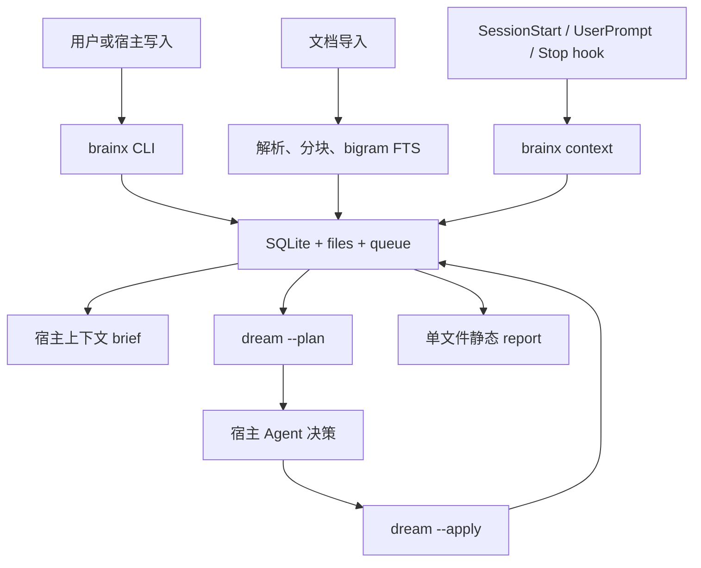

# BrainX 产品需求文档

> 历史设计文档：记录 v1 的产品意图，不是用户手册。实际命令与行为以 [README.md](../README.md) 和代码为准。

## 1. 产品概述

BrainX 是一个本地优先的「长期记忆 + 文档知识库」统一引擎，以单个 Go CLI 二进制交付。它把所有数据保存到一个可整体复制的数据目录中，并通过宿主 hook 将相关记忆自动注入 Agent 上下文。

- 面向需要在本机沉淀私有知识、项目记忆和文档资料的个人 Agent 用户。
- 不依赖常驻服务、云账号、Docker 或模型 API；默认离线运行。

## 2. 核心功能

### 2.1 资产库

1. **初始化与配置**：创建 `$BRAINX_HOME`、SQLite 数据库、文件目录、队列及受校验的配置文件。
2. **记忆写入与查询**：通过 `remember` 写入结构化资产，通过 `recall`、`search`、`get`、`list` 和 `context` 读取。
3. **文档导入与归档**：导入 Markdown、文本、PDF、DOCX、HTML 等文档，保留不可改写的正文，支持本地、纯文本与具名外部归档根。
4. **中文检索**：以 rune 为单位生成字符 bigram，通过 SQLite FTS5 实现二字词检索；单字查询使用受限兜底。
5. **图谱与冲突**：管理资产关系、冲突标注、邻居查询和成对冲突召回。
6. **两段式巩固**：`dream --plan` 输出可解释的候选组，宿主 Agent 给出决策，`dream --apply` 校验并持久化审计记录。
7. **可靠性与可维护性**：WAL、短写事务、重试队列、死信、健康检查、索引修复、审计与迁移导出。
8. **宿主集成**：为 Claude Code、Codex 与 Cursor 生成 hook 配置和标记块式约定文件；全部注入都经 `brainx hook`。
9. **静态报告**：`brainx report` 输出单文件离线 HTML，看板展示库质量、待处理项、趋势、配置和可执行命令。

### 2.2 用户界面与命令

| 界面 | 核心能力 |
|---|---|
| `brainx init` / `config` / `doctor` / `status` | 初始化、配置校验、诊断和可观测性 |
| `remember` / `import` / `forget` / `confirm` | 写入、文档导入、软删除和待确认处理 |
| `recall` / `search` / `context` / `get` / `list` | 分层检索、自动上下文和资产浏览 |
| `link` / `neighbors` / `review` | 图谱关系和冲突标注 |
| `dream` / `audit` / `replay` | 巩固候选、应用、审计与重放 |
| `install` / `hook` | 多宿主适配与自动注入 |
| `export` / `report` | 可迁移备份与离线质量看板 |

## 3. 核心流程

## 4. 关键产品约束

- 所有持久化数据位于 `$BRAINX_HOME`，核心为 `store.db` 与 `files/`；库内文件引用均为相对路径。
- `kind=doc` 的正文不可被巩固、合并或删除；知识类写入只能生成带 `derived_from` 的派生资产。
- 正常路径不进行网络调用或模型调用；向量嵌入和 HTTP 归档根均为显式、默认关闭的例外。
- 写操作必须显式 scope；读操作可推断项目 scope 并通过 stderr 说明依据。
- 不得启动常驻服务；报告通过 `file://` 直接打开。
- 任何写入失败都必须可观测、进入可重试队列或死信，不能静默丢失。

## 5. 静态报告设计

### 5.1 视觉方向

- 信息密度适中的编辑式运维看板，以暖白、石墨灰和单一蓝色强调色构成主色，琥珀色和红色只表达风险。
- 字体采用衬线标题与等宽命令文本，保留终端工具的可信感；避免框架化后台模板外观。
- 桌面优先，窄屏下 KPI 和配置控件单列堆叠。

### 5.2 页面模块

| 模块 | 内容 |
|---|---|
| 头部 | 数据目录、当前 scope、生成时间与版本 |
| KPI | 总资产、今日入库、近七日变化、待处理与队列 |
| 趋势 | 30 天入库量和召回量，可显示均值线 |
| 资产质量 | kind 分布、常用/快衰减/从未召回资产榜 |
| 待办 | pending、冲突、队列和可复制的修复命令 |
| 配置 | 有约束的参数编辑、脏状态提示和写入说明 |

## 6. 验收标准

- `CGO_ENABLED=0 go build` 生成的单二进制可在无外部服务环境使用。
- 中文二字词能通过 FTS5 命中正确片段；`doc` 的内容哈希在巩固前后不变。
- 并行短命写者不会丢写，争锁数据可以补偿并进入可见队列。
- 连续无变化 hook 注入不重复输出 brief；Stop hook stdout 保持为空。
- 迁移测试从导出到异路径导入后，资产、检索和相对文件引用仍可用。
- 静态报告可在不联网、无本地服务的情况下打开和浏览。
