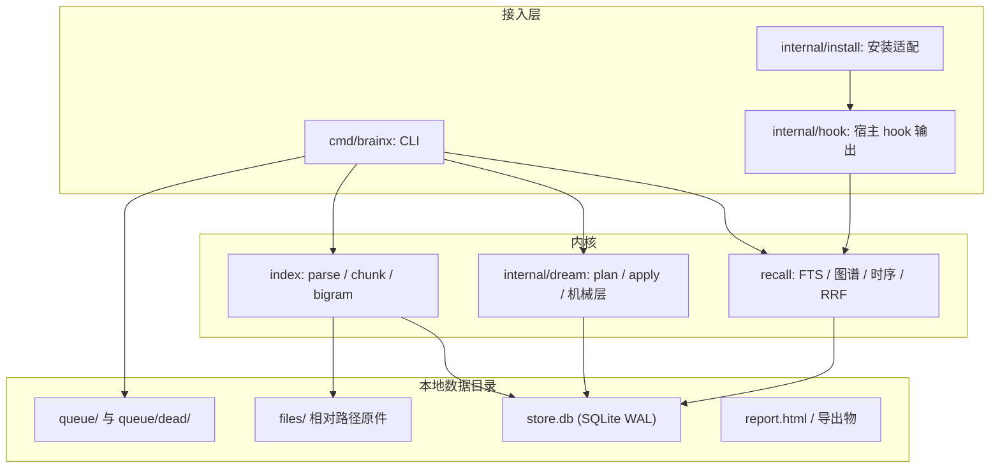
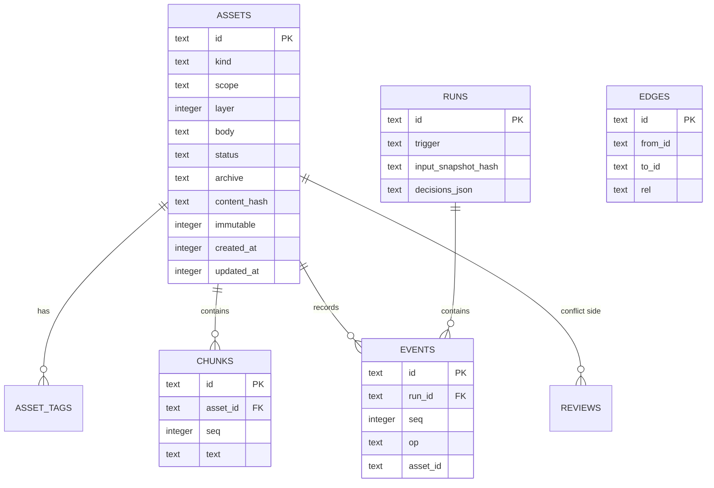

# BrainX 技术架构文档

> 历史设计文档：记录 v1 的设计意图，不是用户手册。命令、安装与实际行为以 [README.md](../README.md) 和代码为准。

## 1. 架构设计

## 2. 技术说明

- **语言与构建**：Go 单模块，Go 标准库优先，`CGO_ENABLED=0` 构建。
- **命令入口**：`cmd/brainx/main.go`，以子命令为唯一真实实现，不需要服务端或代理。
- **数据库**：SQLite + `modernc.org/sqlite` 纯 Go 驱动；启用 WAL、foreign keys、synchronous=NORMAL；FTS5 承载全文检索。
- **存储目录**：默认 `~/.brainx`，包含 `store.db`、`files/`、`queue/`、`queue/dead/`、`manifest.json`、`AGENTS.block.md` 与 `.lock`。
- **报告**：Go 模板生成内嵌 CSS/JS 的 `report.html`；不依赖 CDN、端口或 Web 框架。
- **外部依赖**：默认不联网，不调用模型；可选向量与 URL 原件按配置显式开启。

## 3. 命令边界

| 类别 | 命令 |
|---|---|
| 生命周期 | `init`, `config`, `status`, `doctor`, `scope` |
| 资产 | `remember`, `import`, `get`, `list`, `search`, `recall`, `forget`, `open`, `relink` |
| 关系与审查 | `link`, `neighbors`, `confirm`, `review` |
| 巩固与审计 | `dream`, `audit`, `replay`, `reindex`, `rechunk` |
| 集成与交付 | `context`, `hook`, `install`, `export`, `report` |

## 4. 数据模型

表结构固定为 `assets`、`asset_tags`、`chunks`、`chunks_fts`、`edges`、`runs`、`events`、`reviews`、`meta`。`chunks_fts` 使用 rune bigram 的标题和正文索引；`assets` 保留正文、可变性、归档和时间字段。

## 5. 写入与并发

1. 每次命令启动时读取并校验 `config.json`，无效配置回退默认并写 stderr。
2. 写入在进程内通过单写者队列串行；跨进程使用 `BEGIN IMMEDIATE`、分类 `busy_timeout` 和指数重试。
3. hook 的 session-start/user-prompt 不等待锁，失败即写单独 queue 文件；Stop 进行受预算限制的补偿。
4. 普通命令执行有限 preflight 补偿，`doctor` 可全量处理队列与死信。
5. 文档解析、网络调用与耗时计算均位于数据库事务外；数据库写事务小于 250ms。

## 6. 核心算法

- **分块和检索**：按 rune 分块与 bigram；FTS 取片段命中，按资产聚合；单字查询以受限 LIKE 补救。
- **召回**：词法、图谱邻接、时序三路检索并以 RRF 融合；只包含 `active`，冲突项随后成对追加。
- **巩固**：plan 只计算候选和原因；apply 必须匹配有效 plan token，并以整批事务校验不可变性、决策枚举、合并链及溯源。
- **可变性**：`doc` 恒为 `immutable=1`；派生资产通过 `derived_from` 边追溯原文，任何梦境操作不得修改文档正文。

## 7. 集成与安全

- `hook` 输出只将协议 JSON 写 stdout，诊断全部写 stderr；Stop 不写 stdout。
- `install` 仅更改标记块，字节级幂等，支持预览与卸载；hook 采用绝对可执行路径。
- 库内文件路径存为相对数据目录路径；外部归档存为 `ext:<root>:<relpath>`，热路径不探测可达性。
- `init` 拒绝网络文件系统和已知同步目录，防止 SQLite WAL 损坏。

## 8. 验证策略

- Go 单元测试覆盖 schema、路径规范化、bigram、配置校验、写入、召回、合并链和不可变性。
- 集成测试覆盖 CLI 初始化、写入/检索、hook JSON、队列补偿、导出迁移和静态报告。
- 在无网络环境运行核心套件；使用并发进程测试锁争用与数据完整性。
